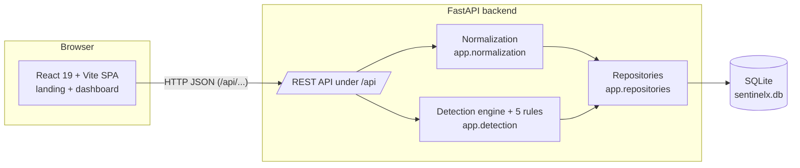
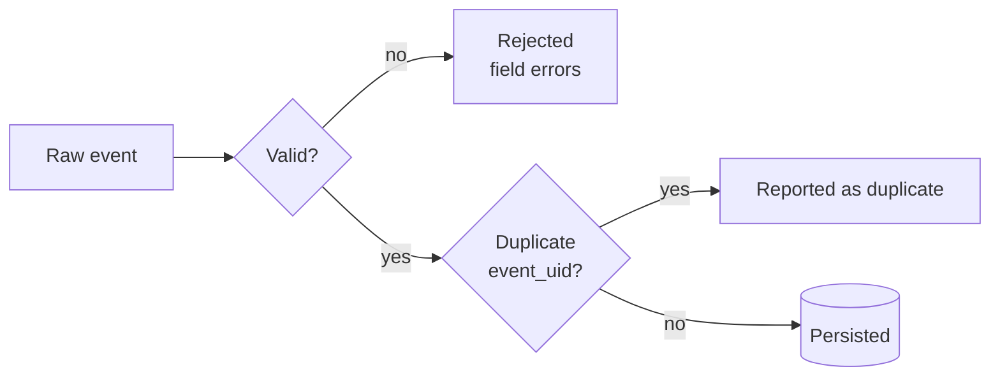

# SentinelX SIEM — Security Information and Event Management Correlation Engine

**Project code:** CIS-117 · **Type:** college project demonstration · **Status:**
feature-complete for a controlled local demo (not deployed; see §16–§17).

SentinelX is a custom, **deterministic** SIEM correlation engine. It ingests
security events, normalizes them to a canonical schema, persists them, correlates
related events using five explicit rules, raises **explainable, evidence-linked,
deduplicated** alerts, and presents everything in a SOC-style dashboard with an
investigation workflow, analytics, and an Attack Simulation Lab.

> There is **no machine learning** and **no AI verdict**. Detection is rule-based
> and reproducible. All data is local; the system never acts against external
> hosts. Synthetic demo data is always flagged (`is_synthetic`) and
> distinguishable from real telemetry.

---

## 1. Problem statement
Security teams drown in raw log events. The signal — a brute-force attempt, a
password spray, a privilege escalation — is buried in volume and scattered across
sources. SentinelX demonstrates the core SIEM idea end to end: collect and
normalize events, correlate them with transparent rules, and surface a small
number of **explainable** incidents an analyst can investigate, with the exact
evidence that triggered each one.

## 2. Objectives & scope
**In scope:** event ingestion + normalization; persistence; five deterministic
correlation rules; explainable, deduplicated alerts with evidence; an
investigation workflow (timeline, status lifecycle, JSON export); analytics; an
Attack Simulation Lab; a typed REST API; deployment *configuration* for Vercel +
Railway.
**Out of scope (documented, not built):** authentication/authorization; machine
learning; multi-user/tenant isolation; real production log-source connectors;
horizontal scale beyond a single SQLite writer.

## 3. Architecture



Component responsibilities:
- **Frontend** (`frontend/`): presentation only. Talks to the backend solely over
  HTTP under `/api`. In development a Vite proxy forwards `/api` to the backend;
  in production it calls the configured backend origin (`VITE_API_BASE_URL`).
- **API routes** (`backend/app/api/`): thin — parse/guard requests, delegate, shape
  responses. No business logic.
- **Normalization** (`backend/app/normalization/`): validates and canonicalizes raw
  events; no database access.
- **Detection** (`backend/app/detection/`): pure rule evaluation + the engine; only
  `service.py` touches the database.
- **Repositories** (`backend/app/repositories/`): all SQL/ORM access; transactional.
- **Database**: a single SQLite file.

## 4. Technology stack & rationale
| Layer | Tech | Why |
|---|---|---|
| Frontend | React 19, Vite, TypeScript, Tailwind, Recharts | Fast SPA dev, typed UI, simple charts |
| Backend | Python 3.10.7, FastAPI, Pydantic v2, SQLAlchemy 2 | Typed, async-ready API with clean validation + ORM boundaries |
| Storage | SQLite | Zero-config, file-based; fits a single-instance demo |
| Tests | Pytest (+ FastAPI TestClient) | Fast, isolated, used throughout |

## 5. Detection rule catalogue (as implemented)
Thresholds below are the rules' `default_params` and can be overridden per
`POST /api/alerts/evaluate` call (enable flags + positive-integer thresholds only).
Severity is set by the **rule**, not by the triggering events.

| ID | Name | Severity | Threshold / window | Correlates by | Triggering events |
|----|------|----------|--------------------|---------------|-------------------|
| AUTH-001 | Brute Force Authentication | high | ≥ 10 failures / 60s | `source_ip` | `authentication_failure` |
| AUTH-002 | Password Spraying | high | ≥ 5 distinct accounts / 300s | `source_ip` (+ `username`) | `authentication_failure` |
| AUTH-003 | Failed Logins Followed by Success | critical | ≥ 5 failures then a success / 300s | `source_ip` + `username` | `authentication_failure` → `authentication_success` |
| NET-001 | Potential Port Scan | medium | ≥ 15 distinct dest ports / 60s | `source_ip` (+ `destination_port`) | `network_connection` |
| PRIV-001 | Suspicious Privilege Escalation | high | priv-esc then ≥ 1 sensitive action / 300s | `username` | `privilege_escalation` → `file_access`/`process_creation` |

Source: `backend/app/detection/rules/`. Each alert stores an `explanation`
(reason, threshold, window, counts, entities).

## 6. Event ingestion & normalization
`POST /api/events/ingest` accepts a single JSON object, a JSON array, or a JSONL
file upload. Each record is normalized (`app/normalization/normalizer.py`):
`timestamp` is required (ISO-8601 or epoch); `source_ip`/`destination_ip` are
validated as IPs; `destination_port` is 0–65535; `event_type` and `severity` are
mapped to controlled vocabularies (unknown → `unknown`/`info`, original preserved
in `raw_event`). Invalid records are rejected **individually** (one bad record
does not fail the batch). Duplicates are detected by `event_uid`. Bounds:
≤ 1000 events/JSON batch, ≤ 5 MB JSON body, ≤ 10 MB / ≤ 10 000 records per JSONL.



## 7. Alert correlation & deduplication
Correlation runs **only** on an explicit `POST /api/alerts/evaluate`. The engine
loads stored events (bounded), runs enabled rules, and **upserts** alerts keyed by
a stable `fingerprint` (rule id + correlation entities). Re-evaluating unchanged
evidence is **idempotent**: `alerts_created = 0`, existing alerts (and their
investigation status) are left unchanged. A genuinely new entity (e.g. a new
`source_ip`) creates a new alert. All alert writes happen in one transaction.

## 8. Evidence & investigation workflow
Each alert records `evidence_event_ids`. `GET /api/alerts/{id}` resolves them to
full event rows (`evidence`). In the dashboard, the alert detail panel shows a
**chronological evidence timeline** (sorted by event time), an **explanation**, a
raw-JSON inspector per event, and cross-navigation to the Event Explorer. Analysts
change the **investigation status** (`open → investigating → … → closed`) via
`PATCH /api/alerts/{id}`; the UI reflects the backend-confirmed value and persists
across refresh. Evidence is never destroyed by a status change.

## 9. Attack Simulation Lab workflow
The Lab (`Simulation Lab` tab) is a teaching tool with explicit, separated steps:
1. **Generate Scenario** — client-side only; builds synthetic events
   (`is_synthetic: true`, RFC 5737 test IPs). No API call, no alerts.
2. **Ingest Events to API** — `POST /api/events/ingest`; shows real counts.
3. **RUN CORRELATION** — `POST /api/alerts/evaluate` then `GET /api/alerts`;
   verdict GENERATED → INGESTED → EVALUATED → DETECTED / NOT DETECTED / FAILED.
The Lab **never creates alerts directly** — it uses the same API as everything
else, and correlation is an explicit user action. A backend/network failure shows
a distinct **FAILED** ("Correlation Failed") state, never a false "no detection".

## 10. Analytics & alert lifecycle
The Overview shows live analytics from the API: KPI counts, **Alerts by
Investigation Status**, **Events by Provenance** (synthetic vs real), severity and
rule breakdowns, and recent feeds. All values come from `GET /api/*/stats` and
list endpoints — no hardcoded counts. Status values: `open`, `acknowledged`,
`investigating`, `resolved`, `false_positive`, `closed`.

## 11. API overview
All routes are under `/api`. Full details + verified examples:
[`docs/api-reference.md`](docs/api-reference.md).

| Method | Path | State-changing | Purpose |
|---|---|---|---|
| GET | `/api/health` | no | Liveness + DB connectivity (200 / 503) |
| POST | `/api/events/ingest` | yes | Ingest event(s) / JSONL |
| GET | `/api/events` | no | List events (paginated/filtered) |
| GET | `/api/events/{id}` | no | One event or 404 |
| GET | `/api/events/stats` | no | Event statistics (incl. synthetic/real) |
| POST | `/api/alerts/evaluate` | yes | Run rules, upsert alerts |
| GET | `/api/alerts` | no | List alerts (paginated/filtered) |
| GET | `/api/alerts/{id}` | no | Alert + resolved evidence, or 404 |
| PATCH | `/api/alerts/{id}` | yes | Update investigation status |
| GET | `/api/alerts/stats` | no | Alert statistics |
| GET | `/api/alerts/rules` | no | Active rule configuration |

> **Security note:** the API currently has **no authentication**. CORS limits
> browser origins only; it is **not** authentication. Do not expose the backend
> publicly without access control (see §17).

## 12. Local installation & startup (Windows PowerShell)
Prerequisites: Python 3.10.x (pinned 3.10.7), Node.js 20.x + npm, Git.

```powershell
# Backend (Terminal 1)
cd backend
python -m venv .venv            # first time only
.\.venv\Scripts\Activate.ps1    # or call the venv python directly
pip install -r requirements.txt # first time only
.\.venv\Scripts\python.exe -m uvicorn app.main:app --host 127.0.0.1 --port 8000
```

```powershell
# Frontend (Terminal 2)
cd frontend
npm install                     # first time only
npm run dev
```

API: `http://127.0.0.1:8000` (health at `/api/health`, dev docs at `/docs`).
Dashboard: the URL Vite prints (`http://localhost:5173` if free).

## 13. Environment variables
Backend (prefix `SIEM_`; examples in `backend/.env.example`):
- `SIEM_ENVIRONMENT` — `development` (default) or `production`.
- `SIEM_DATABASE_URL` — SQLAlchemy URL. Default `sqlite:///./sentinelx.db`.
  Production requires an absolute path on a persistent volume, e.g.
  `sqlite:////data/sentinelx.db` (the app refuses to start on an ephemeral path).
- `SIEM_CORS_ORIGINS` — comma-separated or JSON list of allowed origins.

Frontend (`frontend/.env.example`): `VITE_API_BASE_URL` — backend origin in
production (unset in dev to use the proxy). **Never put secrets in `VITE_*`.**
Railway injects `PORT` (consumed by the start command).

## 14. Running tests
```powershell
cd backend
.\.venv\Scripts\python.exe -m pytest -q
```
Tests use isolated temporary databases; the demo database is never touched.
Latest observed: **70 passed, 1 warning** (2026-10-18). The warning is a Starlette
`TestClient` httpx deprecation (non-fatal).

## 15. Production build
```powershell
cd frontend
npm run build       # tsc --noEmit && vite build  ->  dist/
```
A non-zero PowerShell exit may appear only from Vite's advisory chunk-size
warning; confirm with `cmd /c "npm run build && echo BUILD_RESULT=OK"`.
Latest observed: **BUILD_RESULT=OK** (2026-10-18).

## 16. Deployment preparation status
Deployment is **configured but NOT performed**. Frontend → Vercel (root
`frontend`, `vercel.json` SPA rewrite + headers); backend → Railway (root
`backend`, `railway.json`, start `uvicorn app.main:app --host 0.0.0.0 --port
$PORT`, health `/api/health`, SQLite on a `/data` volume). No Vercel/Railway
deployment has been created or verified. Details: [`docs/phase8-deployment.md`](docs/phase8-deployment.md).

## 17. Security limitations (read before any deployment)
- **No authentication/authorization** on any endpoint. An unrestricted public
  deployment lets anyone read all data and perform writes (ingest, evaluate,
  change status). Suitable only as an **access-restricted controlled demo**.
- CORS is browser-origin control, **not** authentication.
- No storage quota/retention; no automated database backup.
- SQLite is single-writer → run a **single** backend instance.
Full review: [`docs/phase9-security-hardening.md`](docs/phase9-security-hardening.md).

## 18. Troubleshooting (Windows PowerShell)
| Symptom | Safe remedy |
|---|---|
| Backend venv missing | `cd backend; python -m venv .venv; .\.venv\Scripts\Activate.ps1; pip install -r requirements.txt` |
| `pip install` fails | Confirm Python 3.10.x (`python --version`); upgrade pip: `.\.venv\Scripts\python.exe -m pip install --upgrade pip`; re-run install |
| Port 8000 in use | Find owner: `Get-NetTCPConnection -LocalPort 8000 \| Select-Object OwningProcess`; then `Get-Process -Id <PID>` to identify it. Prefer a different port: `... uvicorn app.main:app --port 8010` (do not kill unknown processes) |
| Frontend `npm install` fails | Ensure Node 20.x (`node --version`); delete only `frontend/node_modules` and retry `npm install` (never touch the database) |
| Vite port conflict | Vite auto-selects the next free port; use the URL it prints, or `npm run dev -- --port 5180` |
| API/proxy/CORS failure (dev) | Confirm the backend is running on 8000 and `/api/health` returns 200; the dev proxy is in `frontend/vite.config.ts`. In prod, set `SIEM_CORS_ORIGINS` to the exact frontend origin |
| Database unavailable | `/api/health` returns **503** with `database: "unavailable"`. Confirm the backend process is up and `SIEM_DATABASE_URL` points at a writable path. **Do not delete the database** |
| Alert evaluation failure | The UI shows a distinct **Correlation Failed** state. Re-check the backend is reachable, then click **RUN CORRELATION** again |
| Frontend build failure | Read the `tsc` error (type errors fail the build before Vite). Fix the reported file; re-run `npm run build`. The chunk-size message is a warning, not a failure |

## 19. Suggested demonstration sequence
Short version (full script in [`docs/demo-runbook.md`](docs/demo-runbook.md) and
[`docs/demo-presentation.md`](docs/demo-presentation.md)):
1. Start backend + frontend; show `/api/health` = 200.
2. Landing page → **Open Security Console** → Overview.
3. **Simulation Lab** → Generate an AUTH-001 scenario → **Ingest Events to API** →
   **RUN CORRELATION** → DETECTED → **Open Incident Details**.
4. Show the evidence timeline + explanation; change status and refresh to show
   persistence; export alert + evidence JSON.
5. Show Overview analytics (status + provenance). Explain limitations honestly.

## 20. Future improvements
Authentication/authorization (or platform access control) before any public use;
storage retention/quotas and automated SQLite backup; a frontend CSP once the
backend origin is known; optional real log-source connectors; a client/server
database (e.g. PostgreSQL) to scale beyond a single SQLite writer; CSV/PDF export;
frontend code-splitting.

---
### Documentation map
- [`docs/PROJECT_STATE.md`](docs/PROJECT_STATE.md) — cross-agent source of truth.
- [`docs/api-reference.md`](docs/api-reference.md) — endpoints + verified examples.
- [`docs/technical-walkthrough.md`](docs/technical-walkthrough.md) — end-to-end data flow.
- [`docs/demo-runbook.md`](docs/demo-runbook.md) — step-by-step demo with recovery.
- [`docs/demo-presentation.md`](docs/demo-presentation.md) — talk track + Q&A.
- Phase reports: `docs/phase6…`, `phase7…`, `phase8…`, `phase9…`, `phase10-demo-readiness.md`.
