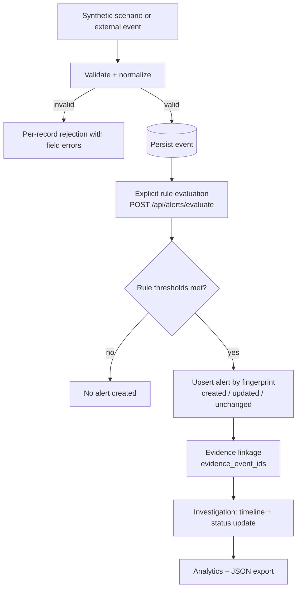

# SentinelX SIEM — Technical Walkthrough

End-to-end explanation of how a security event becomes an investigated incident.
File paths and symbol names below were verified against the source on 2026-10-18.

---

## 1. The pipeline at a glance

Nothing is automatic between **persist** and **evaluate**: correlation runs only
when a user (or client) explicitly calls `POST /api/alerts/evaluate`.

## 2. Ingestion & normalization (real code path)
Entry point: `backend/app/api/events.py::ingest_events`.
- The body is parsed by `_entries_from_json` (single object / array) or
  `_entries_from_jsonl` (multipart `file`). Whole-request guards enforce size and
  record limits (`_IngestInputError` → 400/413).
- `_process_entries` calls `normalize_event` (`app/normalization/normalizer.py`)
  per record:
  - `timestamp` **required**; parsed from ISO-8601 (trailing `Z` handled) or epoch
    seconds; booleans and malformed values rejected.
  - `source_ip` / `destination_ip` validated via Python's `ipaddress`.
  - `destination_port` constrained to 0–65535.
  - `event_type` / `severity` mapped to controlled vocabularies in
    `app/normalization/vocab.py`; unrecognized values become `unknown` / `info`,
    with the **original payload preserved verbatim** in `raw_event`.
  - `event_uid` used as given or generated (`uuid4().hex`).
- In-batch and database duplicate detection by `event_uid`
  (`event_repository.existing_uids`).
- Valid, non-duplicate records are inserted in one transaction
  (`event_repository.add_events`), which commits on success and rolls back on error.
- The route returns an `IngestSummary` and a status code reflecting the mix of
  accepted / rejected / duplicate (201 / 207 / 400 / 200 / 413).

**Why a record can be rejected:** missing/invalid `timestamp`, invalid IP, or an
out-of-range port. Rejections are per-record; one bad row never fails the batch.

## 3. Persistence model
`backend/app/models/event.py` (`events`) and `app/models/alert.py` (`alerts`).
Timestamps are stored as **naive UTC** and re-attached to UTC on output. Key
columns: events carry `event_uid` (unique), `timestamp`, `event_type`,
`source_ip`, `destination_port`, `username`, `host`, `severity`, `is_synthetic`,
and the full `raw_event` (JSON). Alerts carry a unique `fingerprint`, `rule_id`,
`severity`, `status`, correlation entities, `matched_count`,
`evidence_event_ids` (JSON array), `explanation` (JSON), and observation
timestamps. Indices support the default orderings.

## 4. Explicit rule evaluation
Entry point: `app/api/alerts.py::evaluate_alerts` → `service.evaluate_and_persist`
(`app/detection/service.py`):
1. `build_configs(overrides)` merges validated per-call overrides onto
   `default_configs()`. An unknown rule id raises `UnknownRuleError` → HTTP 400.
2. `event_repository.fetch_for_detection` loads events ordered by `(timestamp,
   id)`, bounded by `settings.max_events_scan` (100 000) to keep the scan finite.
3. `engine.evaluate` (`app/detection/engine.py`) runs each **enabled** rule over a
   pure `EventView` list — rules never touch the database.
4. Each detection is upserted by `alert_repository.upsert_alert`; the whole set is
   committed in a single transaction (rollback on error).
5. The route returns an `EvaluateSummary` (`events_evaluated`, `rules_enabled`,
   `detections`, `alerts_created/updated/unchanged`, `alerts[]`).

## 5. The five detection rules (exact implementation)
Source: `backend/app/detection/rules/`. Thresholds are `default_params`;
`POST /api/alerts/evaluate` may override enable flags and positive-integer params.

| Rule | File | Required event(s) | Correlation key | Window | Threshold | Severity |
|------|------|-------------------|-----------------|--------|-----------|----------|
| AUTH-001 Brute Force | `auth_brute_force.py` | `authentication_failure` with `source_ip` | `source_ip` | 60s | ≥ 10 failures | high |
| AUTH-002 Password Spraying | `auth_password_spray.py` | `authentication_failure` with `source_ip` + `username` | `source_ip` | 300s | ≥ 5 distinct usernames | high |
| AUTH-003 Fail→Success | `auth_failure_success.py` | `authentication_failure` then `authentication_success`, same `source_ip` + `username` | `source_ip` + `username` | 300s | ≥ 5 failures before a success | critical |
| NET-001 Port Scan | `net_port_scan.py` | `network_connection` with `source_ip` + `destination_port` | `source_ip` | 60s | ≥ 15 distinct ports | medium |
| PRIV-001 Priv-Esc | `priv_escalation.py` | `privilege_escalation` then `file_access`/`process_creation`, same `username` | `username` | 300s | ≥ 1 sensitive action after escalation | high |

Notes & limitations:
- Rules require their specific fields; events missing them are ignored by that
  rule (e.g. NET-001 ignores connections without a `destination_port`).
- AUTH-003 and PRIV-001 emit at most one detection per correlation key per run.
- PRIV-001 alerts have `source_ip = null` (it correlates by `username`).
- The alert's severity is the **rule's** severity, independent of event severity.
- Sliding-window logic lives in `app/detection/base.py`
  (`mark_count_windows`, `mark_distinct_windows`); the fingerprint is built by
  `make_fingerprint(rule_id, entities)`.

## 6. Why the system is deterministic
Given the same stored events and the same rule configuration, evaluation always
produces the same detections, the same evidence sets, and the same fingerprints.
There is **no randomness, no model inference, and no heuristic scoring** — only
explicit counts/sequences over time windows. This is what makes every alert
**explainable**: the `explanation` object records the exact reason, threshold,
window, counts, and entities (e.g. *"10 authentication failures from
198.51.100.24 within 60s (threshold 10)."*).

## 7. How evidence is associated with alerts
Each rule returns the specific events that satisfied it. `upsert_alert` stores
their primary keys in `evidence_event_ids`. `GET /api/alerts/{id}`
(`app/api/alerts.py::get_alert`) resolves those ids to full event rows via
`event_repository.get_events_by_ids` and returns them as `evidence`. The
dashboard sorts them into a chronological **evidence timeline** by event time.

## 8. How deduplication works
The `fingerprint` is a stable hash of `rule_id` + sorted correlation entities
(`make_fingerprint`). On evaluate, `upsert_alert` looks up the fingerprint:
- **Not found** → new alert (`state: created`, `status: open`).
- **Found and evidence/severity/observation window changed** → `state: updated`
  (investigation `status` and `created_at` preserved).
- **Found and nothing changed** → `state: unchanged` (no write).
So repeatedly evaluating the same events never produces duplicate alerts and
never resets an analyst's status — evaluation is **idempotent**.

## 9. What happens when evaluation fails
If the backend request errors or is unreachable, the API rolls back its
transaction and returns an error; the frontend routes this to a distinct
**FAILED / "Correlation Failed"** state in both the Alerts view and the
Simulation Lab (`SimulationLabView.tsx` state `evaluation_failed`). A failure is
**never** rendered as a successful "no detection" verdict — this distinction was
introduced and verified in Phase 6.

## 10. Why a scenario can ingest yet produce no alert
Ingestion only **stores** events; it never creates alerts. An alert appears only
if, at the next explicit evaluation, some rule's threshold is actually met. If a
scenario is below threshold (e.g. 9 failures when AUTH-001 needs 10), or the
events lack the required fields, evaluation legitimately yields
`detections: 0` and no alert — correct behavior, not a bug.

## 11. Why simulation does not directly create alerts
The Attack Simulation Lab (`frontend/src/components/views/SimulationLabView.tsx`,
generator `src/utils/scenarioGenerator.ts`) only (1) builds synthetic events
client-side, (2) ingests them via `POST /api/events/ingest`, and (3) calls the
**same** `POST /api/alerts/evaluate` as the rest of the app when the user clicks
**RUN CORRELATION**. There is no special "create alert" path. `evaluateAlerts()`
has exactly two call sites, both explicit button handlers — confirmed by source
search. This keeps the demo honest: detection is the real engine's output.

## 12. Synthetic vs real telemetry
Every event carries `is_synthetic`. Simulation events set `is_synthetic: true`
and use RFC 5737 test IP ranges; the UI shows a provenance badge, and
`GET /api/events/stats` reports `synthetic_count` vs `real_count`. Synthetic data
is therefore always distinguishable and never silently mixed with real telemetry.

## 13. Current SQLite constraints
- **Single writer:** SQLite serializes writes; run **one** backend instance.
  Multiple replicas on one file risk "database is locked" errors or corruption.
- **Local file:** persistence depends on the file surviving. In production the
  app requires an absolute path on a mounted volume and refuses an ephemeral path
  (`app/db/init_db.py::validate_persistence_config`).
- **No automated backup.** Recovery would be a manual copy of the DB file.
- Suitable for a single-instance demo; scaling out requires a client/server
  database (e.g. PostgreSQL via `SIEM_DATABASE_URL`, which SQLAlchemy supports,
  though it is not currently exercised or tested).

## 14. Security implication of the missing auth layer
There is **no authentication or authorization**. If the backend is reachable,
any client can read all events/alerts/evidence and perform writes: ingest events,
trigger correlation, and change alert statuses (`PATCH /api/alerts/{id}`). CORS
restricts only browser origins — it is **not** auth and does not stop curl or
scripts. Consequences: data confidentiality/integrity loss, storage exhaustion
(no quota), and investigation tampering. **Mitigation:** treat the deployment as
an access-restricted controlled demo; do not expose it publicly without platform
access control or a real auth layer. Full analysis and an implementation plan are
in `docs/phase9-security-hardening.md`.
